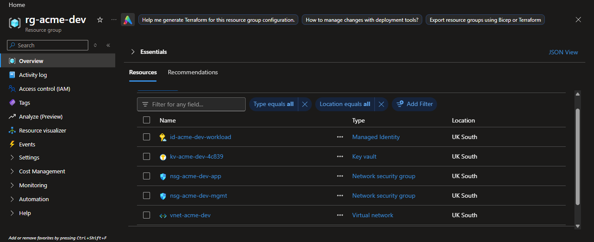
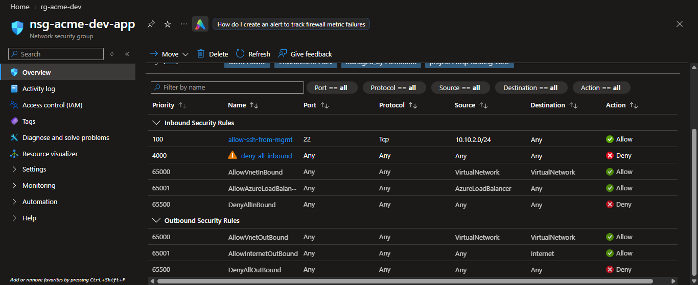
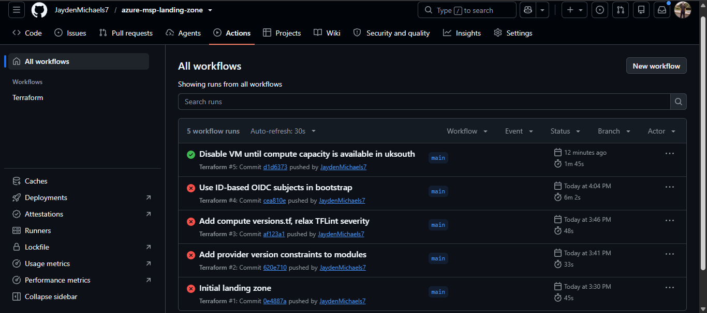
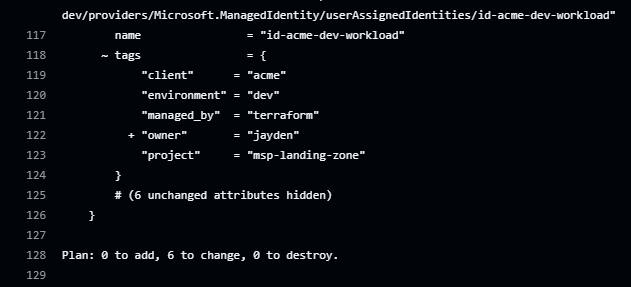
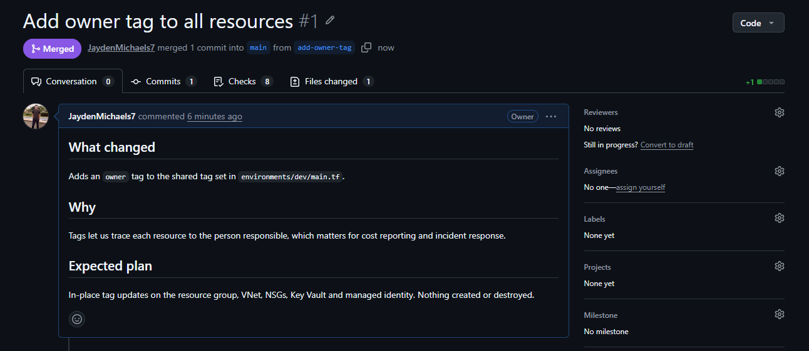
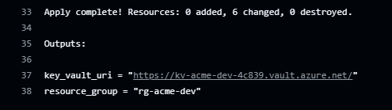
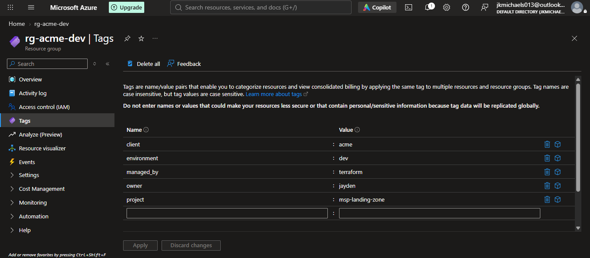

# Azure MSP Client Landing Zone

A secure, isolated network + compute environment for a managed client, built entirely
with Terraform and deployed by GitHub Actions. One client = one environment folder.

## Architecture

```
Resource group: rg-<client>-<env>
├── networking   VNet 10.10.0.0/16
│                ├── snet-app   (NSG: SSH only from mgmt subnet, deny all other inbound)
│                └── snet-mgmt  (NSG: deny inbound from Internet)
├── security     Key Vault (RBAC mode) + user-assigned managed identity
│                ├── pipeline identity -> Key Vault Secrets Officer
│                └── workload identity -> Key Vault Secrets User (read only)
└── compute      Ubuntu 22.04 VM (Standard_B1s), SSH key only, NO public IP,
                 managed identity attached
```

NSGs are stateful layer-4 packet filters, not firewalls in the Azure Firewall sense.
This design uses them for segmentation; production would add Azure Firewall / private endpoints.

## Setup

**Prereqs:** Azure free account, Azure CLI, Terraform >= 1.6, GitHub account, an SSH key pair
(`ssh-keygen -t ed25519 -f ~/.ssh/msp_lab`).

1. **Create the GitHub repo** `azure-msp-landing-zone` and push this code to it *after* step 3.
2. **Bootstrap once, locally** (creates remote-state storage and the GitHub OIDC identity):
   ```bash
   az login
   cd bootstrap
   cp terraform.tfvars.example terraform.tfvars   # fill in subscription_id and github_org
   terraform init && terraform apply
   terraform output
   ```
3. **Add GitHub repo variables** (Settings > Secrets and variables > Actions > *Variables*):
   `AZURE_CLIENT_ID`, `AZURE_TENANT_ID`, `AZURE_SUBSCRIPTION_ID`, `TFSTATE_RG`, `TFSTATE_SA`
   (from the bootstrap outputs) and `SSH_PUBLIC_KEY` (contents of `msp_lab.pub`).
   Then create a GitHub **Environment** named exactly `dev`.
4. **Push to `main`.** CI validates and scans, then the apply job deploys.
5. **Prove the PR flow:** branch, change a tag, open a PR, read the plan, merge.

## Pipeline

| Event | What runs |
|---|---|
| Any push | fmt, validate, TFLint, Checkov |
| Pull request to main | the above + `terraform plan` |
| Push to main | the above + `terraform apply` (GitHub Environment `dev`) |
| Manual (Actions tab) | `apply` or `destroy` |

## Cost guardrails

- **Free-account VM offer is 12 months from account creation, new customers only.** After that, the VM bills.
- Set `enable_compute = false` (or run the manual **destroy**) when you are not demoing.
- Create a $5 budget alert in Cost Management.
- No public IP, NAT gateway, Bastion or Azure Firewall: those bill hourly.
- Key Vault bills per operation (pennies at lab volume); it is not a free tier.
- If the free-account OS disk allowance doesn't cover the VM disk, you'll see a small
  disk charge in Cost Management. Check after day 1.

## Known trade-offs (say these in interviews)

- Demo secret value is in Terraform state. State is private, versioned and Entra-auth only; real client secrets would be set out-of-band.
- Key Vault allows public network access so GitHub runners can write secrets. Production: private endpoint + firewall.
- `purge_protection_enabled = false` so the lab can be destroyed. Production: true.
- Checkov runs report-only until findings are triaged.

## Verify it works (no public IP, so use the control plane)

```bash
az vm run-command invoke -g rg-acme-dev -n vm-acme-dev-app \
  --command-id RunShellScript --scripts "hostname && ip a"
```

## Adding another client

Copy `environments/dev` to `environments/<client>-prod`, change `client_name`, the state `key`,
and (for a separate Environment/approval gate) add a matching federated credential in bootstrap.

## Results

### Deployed resources (rg-acme-dev)


### NSG rules created by Terraform


### Pipeline history


### Pull Request Plan


### Pull Request Merged


### Terraform Apply


### Azure Tags (rg-acme-dev)


## What went wrong and how I fixed it

### 1. TFLint failed the first pipeline runs
**Symptom:** The validate job failed with `exit code 2`: "Missing version constraint
for provider" and "terraform required_version attribute is required".
**Cause:** My modules didn't declare which Terraform and provider versions they need,
so a future provider release could silently change their behaviour.
**Fix:** Added a `versions.tf` to each module with `required_version` and pinned
provider constraints.

### 2. Azure rejected the pipeline's login
**Symptom:** `terraform init` failed with `AADSTS700213: No matching federated
identity record found`.
**Cause:** GitHub sent an ID-qualified OIDC subject
(`repo:<owner>@<id>/<repo>@<id>:environment:dev`), but I had registered the plain form.
**Fix:** Added the owner and repo IDs as bootstrap variables, updated both federated
credentials, and re-applied. The pipeline now authenticates with no stored secrets.

### 3. The VM could not be created
**Symptom:** `SkuNotAvailable ... Capacity Restrictions: Standard_B1s is currently
not available in location 'uksouth'`.
**Cause:** `az vm list-skus` only reports what my subscription may use. It cannot show
whether Azure has spare capacity, which only appears at deployment.
**Fix:** Added an `enable_compute` switch so the network, identity and Key Vault could
deploy without the VM. The VM can be re-enabled through a pull request when capacity returns.

### What I took from it
Reading the log to find the cause beat guessing. Capacity and quota are real
constraints that code review cannot catch.

**Retry:** I added a `zone` parameter to the compute module and retried with the VM
pinned to zones 1, 2 and 3. All three returned `SkuNotAvailable` (capacity
restrictions for Standard_B1s in uksouth), so the shortage covers the whole region,
not a single zone. The VM stays disabled behind the `enable_compute` flag, and the
rest of the landing zone is deployed.

## Security scanning

Every push runs two IaC scanners, **Checkov** and **Trivy** (the successor to tfsec,
which is no longer maintained). Both are blocking: **Validate and scan** is a required
status check in the `main` ruleset, so a new finding stops a merge until it is fixed or
documented.

The first scan reported 14 Checkov findings and 2 Trivy findings. I sorted each one
into fix, accept, or out of scope.

### Fixed
| Finding | Change |
|---|---|
| Key Vault secret had no expiry date (`CKV_AZURE_41`) | Added `expiration_date` to the demo secret |
| OIDC credential could be used by any branch workflow (`CKV_AZURE_249`) | Restricted the `dev` GitHub Environment to the `main` branch; subject claims are pinned to one repository |

### Accepted, with the reason written next to the code
| Finding | Reason |
|---|---|
| State storage and Key Vault reachable from the internet (`CKV_AZURE_59`, `CKV_AZURE_189`, `CKV_AZURE_109`, `CKV2_AZURE_33`, `CKV2_AZURE_32`, Trivy `AZU-0012` and the Key Vault network rule) | GitHub-hosted runners have changing IP addresses, so locking these down needs private endpoints and self-hosted runners (paid). Access is Entra ID only, shared keys are disabled, and TLS 1.2 is the minimum |
| Purge protection and recoverability off (`CKV_AZURE_110`, `CKV_AZURE_42`) | Off in the lab so `terraform destroy` works. Production would turn it on |
| LRS replication (`CKV_AZURE_206`) | Cost. Production state would use GRS or ZRS |
| Queue service logging (`CKV_AZURE_33`) | The Queue service is not used |

### Out of scope for a free-tier lab
Customer-managed encryption keys (`CKV2_AZURE_1`) and blob read logging
(`CKV2_AZURE_21`) need extra Key Vault keys and a Log Analytics workspace.

Accepted findings are suppressed inline (`#checkov:skip=ID:reason`) or in
`.trivyignore`, each with a written reason, so every exception is a visible decision.